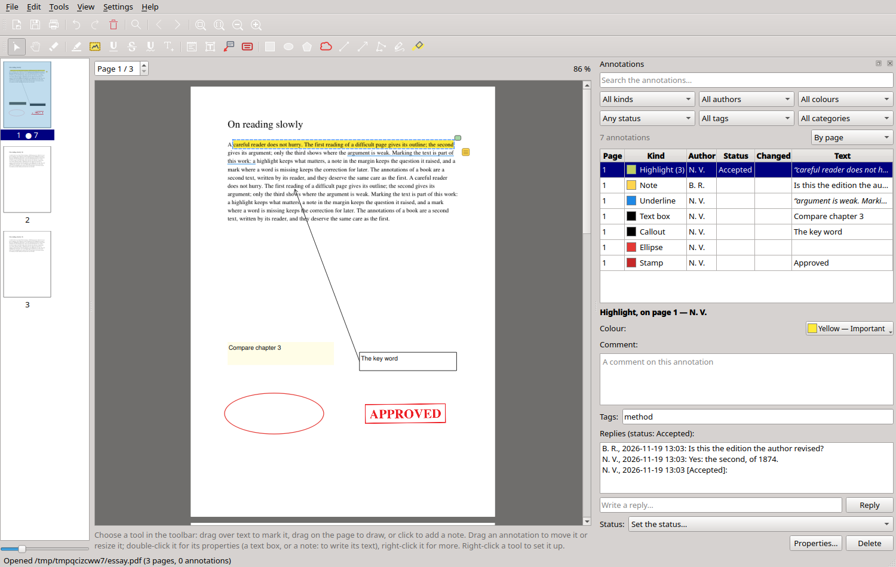
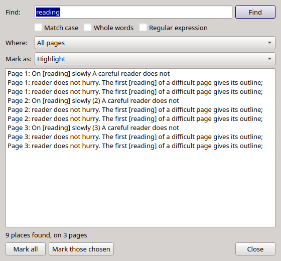
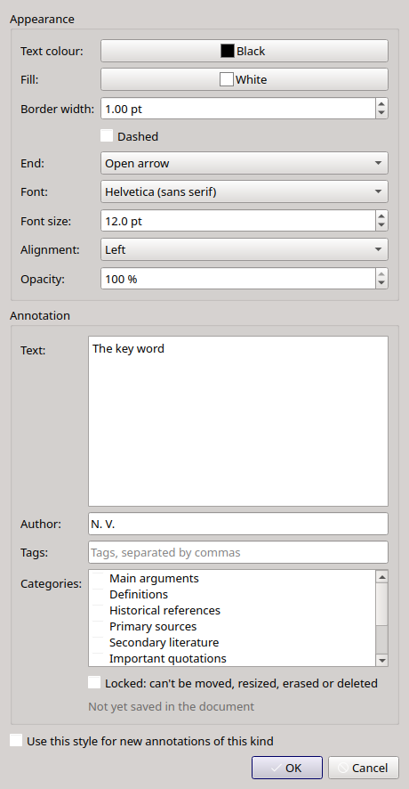
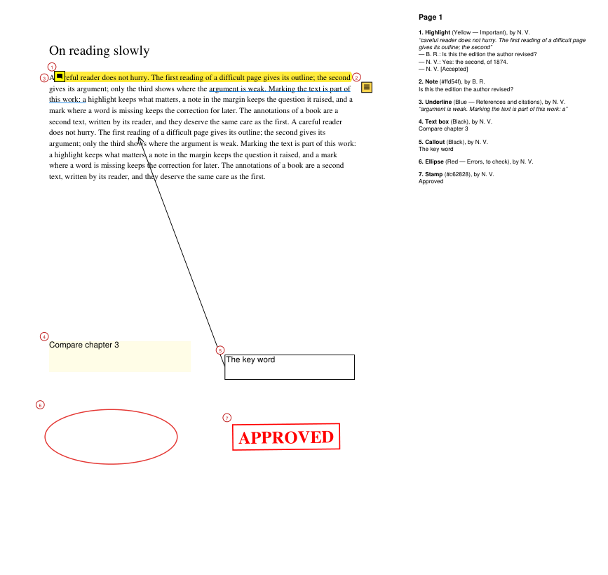

py-annotate
===========

*(Español: [README_es.md](README_es.md))*

py-annotate adds annotations to PDF documents: highlights, underlines and
strikeouts over the text, marks where text is to be inserted, notes, text
boxes and callouts, highlighted regions, rectangles, ellipses, polygons,
clouds, lines, arrows, drawings and highlights made by hand, and stamps.
Each one can carry a comment, the name of its author, the dates when it was
made and last changed, replies, a review status, tags and categories.

They are written as ordinary PDF annotations, not painted into the pages.
Any PDF viewer shows them, lists them with their comments, and can change
or remove them; the pages under them stay as they were. The annotations
that a document already has (of the kinds above) are read when it is
opened, so they can be moved, changed or deleted too. Saving changes only
the annotations that changed, and changes them where they are, so that
what py-annotate doesn't know of them is kept; links, file attachments and
form fields are never touched. The changes are added at the end of the
file, so that a signed document keeps its signatures valid for what they
signed.

It has a window, in English and in Spanish, and works on Linux, Windows and
macOS. This is version 0.4.3.

I am Nicolas Vaughan (<nicolasvaughan@proton.me>), and I wrote it in 2026.
It is free software, under the GNU General Public License, version 3 or
later (see "Licensing").

Screenshots
-----------

An essay with a highlight (with replies, a review status and a tag), a
note, an underline, a text box, a callout, an ellipse and a stamp:

Find and highlight, and the properties of a callout:

 

A page of the summary of the comments:

These pictures (four in each language) are made by `uv run python
tools/screenshots.py`, which draws the window out of sight, on an essay it
writes each time, and saves them in `docs/img/`.

Installation
------------

Every version is in the [releases](https://github.com/nivaca/py-annotate/releases),
on GitHub and on [Codeberg](https://codeberg.org/nivaca/py-annotate/releases),
with these files:

    py-annotate-VERSION.zip                 the source, with the installers
    py-annotate-VERSION-x86_64.AppImage     the AppImage (Linux)
    py-annotate-VERSION-1.fc45.noarch.rpm   the Fedora package, signed
    RPM-GPG-KEY-py-annotate                 the key that signs it
    py_annotate-VERSION.tar.gz              the source package, for Python
    py_annotate-VERSION-py3-none-any.whl    the wheel, for Python

**AppImage (any Linux).** It needs nothing else: it brings its own Python,
Qt and PyMuPDF, and runs with glibc 2.34 or later (Ubuntu 22.04, Debian 12,
Fedora 35 and later). Make it executable and run it:

    $ chmod +x py-annotate-*-x86_64.AppImage
    $ ./py-annotate-*-x86_64.AppImage [file.pdf]

**Fedora.** From [Copr](https://copr.fedorainfracloud.org/coprs/nivaca/py-annotate/),
for Fedora 45 and later, with Fedora's own Python, PyMuPDF and PySide6, a
menu entry and the manual (`man py-annotate`):

    $ sudo dnf copr enable nivaca/py-annotate
    $ sudo dnf install py-annotate

Updates then come with `sudo dnf upgrade`. The RPM of each release can also
be installed by hand, after importing its key: `sudo rpm --import
RPM-GPG-KEY-py-annotate`.

**With the installers (Windows, macOS, Linux).** They need Python 3.14 or
later. Unpack `py-annotate-VERSION.zip` (or clone the source), and run the
installer of the folder `install/`:

    > install\install.bat               Windows: install, or update
    > install\install.bat -Desktop      also a shortcut on the desktop
    > install\install.bat -Uninstall
    $ install/install.sh                macOS and Linux: install, or update
    $ install/install.sh --uninstall

Each one makes a Python environment of its own for py-annotate, installs it
there with PyMuPDF and PySide6 (downloaded from PyPI, so it needs internet
the first time), and adds it to the menu of the system (the Start menu on
Windows; `~/Applications` on macOS). Nothing needs administrator rights,
and the settings are never touched.

**From the source**, with [uv](https://docs.astral.sh/uv/):

    $ git clone https://github.com/nivaca/py-annotate.git
    $ cd py-annotate
    $ uv run py-annotate [file.pdf]

A PDF can also be opened from File > Open, or dropped on the window. To
save copies as PDF/A or PDF/X, [pdf2iso](https://github.com/nivaca/pdf2iso)
is needed too (see "Saving, exporting, importing").

The pages
---------

The pages are shown one under the other, and scrolled through; View >
Continuous scrolling, unticked, shows one page at a time. The thumbnails on
the left say how many annotations each page has; the slider under them
makes them larger or smaller.

The tools
---------

Choose a tool in the second toolbar, in the Tools menu, or with its key
(the keys can be changed: see "Settings"):

| Tool               | Key     | What it does                                                 |
|--------------------|---------|--------------------------------------------------------------|
| Select             | V       | selects, moves and resizes; drag around annotations to select several |
| Hand               | M       | dragging moves the pages in the window                       |
| Eraser             | E       | drag over annotations to erase them; over a drawing, only what it touches |
| Highlight          | H       | drag over text                                               |
| Area highlight     | Shift+H | drag over a region: a picture, a table, a scanned page        |
| Underline          | U       | drag over text                                               |
| Strikeout          | S       | drag over text                                               |
| Squiggly underline | Q       | drag over text                                               |
| Insert text        | I       | click where text is missing, and write it                     |
| Note               | N       | click on the page, and write the note                         |
| Text box           | T       | drag a box, or click, and write the text                      |
| Callout            | Shift+T | press on the place to point at, drag to where the text goes   |
| Stamp              | Shift+S | click (or drag, for its width) where the stamp goes           |
| Rectangle          | R       | drag on the page                                             |
| Ellipse            | O       | drag on the page                                             |
| Polygon            | G       | click each corner; double-click or Enter to end               |
| Cloud              | Shift+G | drag on the page                                             |
| Line               | L       | drag on the page                                             |
| Arrow              | A       | drag on the page                                             |
| Polyline           | Shift+L | click each point; double-click or Enter to end                |
| Freehand           | P       | draw on the page; with a tablet's pen, pressing harder draws wider |
| Freehand highlight | Shift+P | highlight by hand, where there is no text to drag over        |

The text of a text box, a callout, a note or an insert-text mark is written
on the page, where it goes: Ctrl+Enter, or a click elsewhere, keeps it, and
Escape gives it up. A double-click on one of them writes its text again.
In a text box or a callout, Ctrl+B, Ctrl+I and Ctrl+U make the chosen text
bold, italic or underlined, and the right-click menu gives it another colour
or font (Helvetica, Times or Courier); the border can have a colour of its
own, in the properties.

With the pen of a tablet (a Wacom, for instance), the freehand tools follow
the pen itself, which is finer and quicker than the mouse it also moves,
and the line is smoothed a little; pressing harder draws wider. Turned
over, the pen's eraser end erases, whatever tool is chosen, until it is
lifted. Settings say how the pressure counts (along each stroke, once for
each stroke, or not at all) and how hard the pen must press (soft, normal
or firm).

Right-clicking a tool in the toolbar gives its colours, the stamp it puts
(the standard ones, such as Approved, Draft or Confidential, or one of your
own, with your name and the date under its text), and its properties: how
the annotations it makes look, whether the tool stays chosen after making
one (or goes back to Select), and what opens after each one is made (a
place for its text, its comment, its properties, or nothing).

Tools > Find and highlight (Ctrl+F) looks for a word, a phrase or a regular
expression, on all the pages or from the page shown, lists the places found
with the words around them, and highlights (or underlines, strikes out...)
all of them, or those chosen.

Editing annotations
-------------------

With any tool, an annotation is selected by clicking it (Ctrl adds it to the
selection), moved by dragging it or with the arrow keys (Shift: ten points
at a time), and resized by dragging its edges and corners. The points of a
line, a polygon or a polyline, and the place a callout points at, are
dragged one by one; the box of a callout moves on its own. Marks over text
belong to their text, and are not moved. With a tool for text, a
double-click marks one word.

The properties of an annotation (Alt+Enter, or a double-click on one that
has no text of its own) are its colour and fill, line width, dashes, the
ends of a line (arrows, circles, squares...), the font, size and alignment
of a text box, the icon of a note, its opacity, its text or comment, its
author, its tags and categories, and whether it is locked (a locked
annotation can't be moved, resized, erased or deleted). Right-clicking it
gives a menu with more: its colour, status and categories; copy the text it
marks, or copy it as a quotation with the name of the document and the
page; change a highlight into an underline; use its style for new
annotations; align several.

The Edit menu has Copy, Paste and Duplicate (annotations can be pasted on
another page, or in another document), Lock, Align (sides, centres, the
same size, spread evenly), and the selection of the annotations of a page,
or of those of the same kind. Group (Ctrl+G) makes the selected annotations
one group, even across pages: a click on one selects them all, and they are
moved, copied and deleted together; Ungroup (Ctrl+Shift+G) undoes it. They
are written as PDF groups, which other viewers that know them also keep
together.

The Layers menu puts annotations in layers: each layer can be shown or
hidden, new annotations go to the layer chosen there, and the selected ones
can be moved to another; a new layer is made there too. A hidden layer is
neither drawn nor listed. The layers are the PDF's own optional content, so
other viewers show and hide them too, and the document keeps which are
shown.

The panel of the annotations
----------------------------

The panel on the right lists all the annotations of the document, with
their page, kind, author, review status, date and comment (or, for marks
over text, the text they mark). It can be sorted by page, by date, by kind,
by author or by status; searched (comments, texts marked, replies, tags,
categories, authors); and filtered by kind, author (with how many
annotations each has), colour, status, tag and category. Even with
thousands of annotations it is listed at once.

Below the list is the annotation selected: its colour, its comment (C puts
the cursor there), its tags, and its replies, with a field to write one and
a list of review statuses (Accepted, Rejected, Cancelled, Completed, No
status). A status is a reply too, so that the history of a review stays
with the annotation. A double-click on a reply changes it; Delete takes it
out.

View > Next annotation (Alt+Down) and Previous annotation (Alt+Up) go
through the annotations in the order of the list, and only through those it
shows. View > Show the annotations hides them all, to see the document as
it is; View > Only those the list shows leaves on the pages only those the
search and filters let through. The panel can be hidden (View > The panel
of the annotations, or F4), moved to the left side of the window, or taken
out of it.

Saving, exporting, importing
----------------------------

File > Save writes the annotations in the document itself; File > Save as
writes a copy with them, and goes on with the copy. Everything can be
undone (Ctrl+Z), before and after saving. File > Print prints the pages
with their annotations.

File > Save a copy writes a flattened copy (the annotations become part of
the pages: every viewer shows and prints them, but they can no longer be
edited), a copy without any annotation, or a copy as PDF/A-1b, PDF/A-2b,
PDF/A-3b (for archiving) or PDF/X-4 (for printing). These are made by
[pdf2iso](https://github.com/nivaca/pdf2iso), which must be installed: it
is looked for on the PATH, in `~/bin` and in `~/.local/bin`, or Settings
say where it is; without it, those entries are greyed out. Ghostscript,
which pdf2iso uses, leaves out some kinds of annotations (insert-text marks,
polygons and clouds, at least). If it does, py-annotate says which, and
offers to make those part of the pages instead, keeping the others as
annotations. PDF/A and PDF/X can't have a password, so the copy of a
protected document has none.

A scanned page has no text, only its image, so its words can't be found,
copied or marked. File > Save a copy > Searchable (OCR) reads the text of
the scanned pages with [Tesseract](https://github.com/tesseract-ocr/tesseract)
and writes it under their images, invisible, where each word is on the
image; then it offers to open the copy, whose text can be marked like any
other. Tesseract must be installed (on Fedora, `sudo dnf install tesseract
tesseract-langpack-eng`, and other languages as `tesseract-langpack-lat`...);
the languages it reads are set in Settings, as `eng`, or several, as
`lat+eng`. The OCR is done on this machine: nothing is sent anywhere.

For the study and edition of texts, any annotation (usually a highlight
over the passage) can carry an entry of textual criticism: its kind
(variant reading, manuscript reading, emendation, conjecture, lacuna,
illegible passage, scribal correction, marginal or interlinear addition,
deletion, abbreviation, expansion, uncertain interpretation, editorial
intervention, palaeographical or codicological observation), the reading of
the text and the other reading, the witness (its siglum) and the location in
it, the source, the rationale and how certain it is. The kind is given from
the right-click menu (Textual criticism), the rest in the properties; the
list searches all of it. The critical apparatus exported has an entry for
each, in the order of the text: `p. 3 iustitia ] iusticia B (f. 3r) —
Variant reading; probable.` The entries are kept in the PDF in a key of
py-annotate's own, which other programs leave alone.

File > Export the annotations writes those the list shows:

* as a report in Markdown (how many there are of each kind, colour and
  author, then each of them with the text it marks and its comment, page by
  page);
* as a table (CSV);
* as a critical apparatus in Markdown (see below);
* as JSON, which holds all there is to know of them and can be imported
  again;
* as XFDF, the format in which PDF programs exchange annotations (with
  their replies and statuses; tags and categories are py-annotate's own, and
  are left out);
* as a summary of the comments: a PDF with each page that has annotations,
  numbered, beside the list of them, with the text they mark, their
  comments and their replies.

File > Import annotations brings them in from a JSON file, from an XFDF
file, or from another copy of the PDF, for instance one annotated by
someone else; their authors are kept, and those already in the document are
left out.

While there are annotations not yet saved, a recovery copy of them is kept
every two minutes. If the program stops before they are saved, they are
offered when the document is opened again (if the file has not changed
meanwhile).

Settings
--------

Settings > Settings has four parts:

* General: the name written as author in new annotations, how often the
  recovery copy is kept, where pdf2iso is (empty: looked for), and a way to
  put the tools back as they were at first.
* Colours: the colours offered in the menus, and what each one means to you
  (by default, yellow for what is important, green for definitions, blue for
  references, pink for questions, orange for arguments, purple for context,
  red for errors to check). The meanings are shown with the colours in the
  menus, the list and the exported files.
* Shortcuts: the key of each tool and action. Two actions can't have the
  same key.
* Categories: those annotations can be put in (by default: main arguments,
  definitions, historical references, primary sources, secondary
  literature, important quotations, questions, contradictions,
  methodological observations, editorial problems).

The language is chosen in Settings > Language.

These settings are kept in a small TOML file, `config.toml`, in
`~/.config/py-annotate` on Linux, `~/Library/Application Support/py-annotate`
on macOS, and `%APPDATA%\py-annotate` on Windows (`$PY_ANNOTATE_CONFIG`
names another folder); the recovery copies, in the folder `recovery` beside
it. Deleting the file gives back the usual values.

How py-annotate was made, and how it keeps the annotations in the PDF, is
told in [docs/DESCRIPTION.md](docs/DESCRIPTION.md).

What it does not do yet
-----------------------

* Annotations that rotate are not there yet.
* Annotations of other kinds (links, attached files, sounds, measurements)
  are shown in the list, locked, but cannot be edited; they are kept as they
  are, and left out of the exports unless the list shows only them.
* The text of a text box has one size, and only Helvetica, Times and Courier.
* A drawing in PDF has one width all along: when the pressure of a tablet's
  pen changes along a stroke, the stroke is cut into drawings of up to five
  widths, made one group, so it goes wider and narrower in steps, not
  smoothly.
* A document with a password is saved whole, not incrementally.

Tests
-----

    $ uv run pytest

Licensing
---------

py-annotate is free software: you can redistribute it and/or modify it
under the terms of the GNU General Public License as published by the Free
Software Foundation, either version 3 of the License, or (at your option)
any later version. It is distributed in the hope that it will be useful,
but WITHOUT ANY WARRANTY; without even the implied warranty of
MERCHANTABILITY or FITNESS FOR A PARTICULAR PURPOSE. See the file
[LICENSE](LICENSE) for the details.
