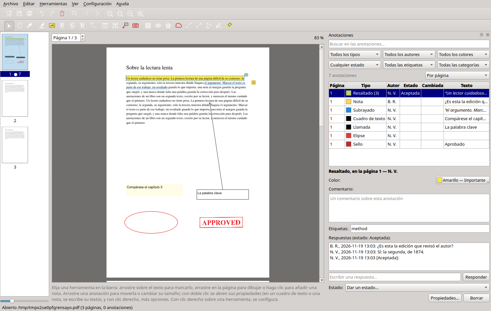
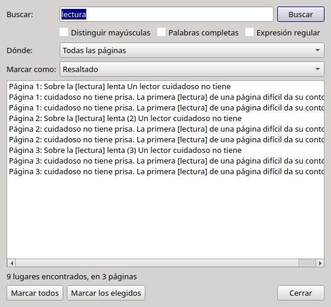
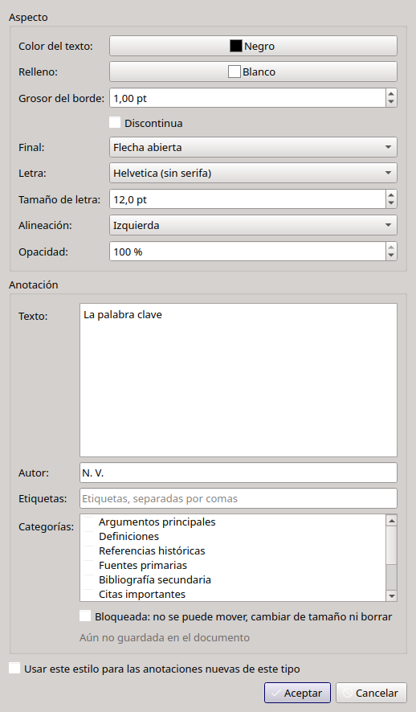
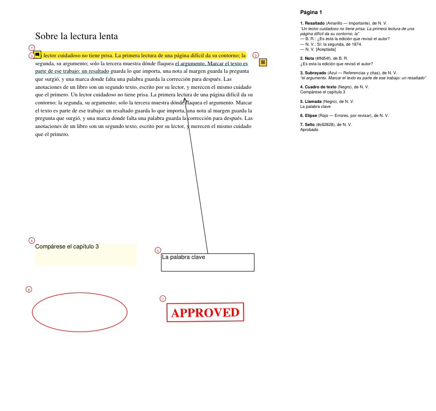

py-annotate
===========

*(English: [README.md](README.md))*

py-annotate añade anotaciones a documentos PDF: resaltados, subrayados y
tachados sobre el texto, marcas donde falta insertar texto, notas, cuadros
de texto y llamadas, zonas resaltadas, rectángulos, elipses, polígonos,
nubes, líneas, flechas, dibujos y resaltados a mano alzada, y sellos. Cada
una puede llevar un comentario, el nombre de su autor, las fechas en que se
hizo y se cambió por última vez, respuestas, un estado de revisión,
etiquetas y categorías.

Se escriben como anotaciones PDF corrientes, no se pintan en las páginas.
Cualquier visor de PDF las muestra, las lista con sus comentarios y puede
cambiarlas o quitarlas; las páginas debajo quedan como estaban. Las
anotaciones que el documento ya tenga (de los tipos dichos) se leen al
abrirlo, así que también se pueden mover, cambiar o borrar. Al guardar se
cambian solo las que cambiaron, y se cambian donde están, de modo que se
conserva lo que py-annotate no sabe de ellas; los enlaces, los archivos
adjuntos y los campos de formulario no se tocan nunca. Los cambios se
añaden al final del archivo, así que un documento firmado conserva sus
firmas válidas para lo que firmaron.

Tiene una ventana, en español y en inglés, y funciona en Linux, Windows y
macOS. Esta es la versión 0.3.2.

Soy Nicolas Vaughan (<nicolasvaughan@proton.me>) y lo escribí en 2026. Es
software libre, bajo la Licencia Pública General de GNU, versión 3 o
posterior (véase «Licencia»).

Capturas
--------

Un ensayo con un resaltado (con respuestas, un estado de revisión y una
etiqueta), una nota, un subrayado, un cuadro de texto, una llamada, una
elipse y un sello:

Buscar y resaltar, y las propiedades de una llamada:

 

Una página del resumen de los comentarios:

Estas imágenes (cuatro en cada idioma) las hace `uv run python
tools/screenshots.py`, que dibuja la ventana fuera de la vista, sobre un
ensayo que escribe cada vez, y las guarda en `docs/img/`.

Instalación
-----------

Cada versión está en las [publicaciones](https://github.com/nivaca/py-annotate/releases),
en GitHub y en [Codeberg](https://codeberg.org/nivaca/py-annotate/releases),
con estos archivos:

    py-annotate-VERSIÓN.zip                 el código fuente, con los instaladores
    py-annotate-VERSIÓN-x86_64.AppImage     la AppImage (Linux)
    py-annotate-VERSIÓN-1.fc45.noarch.rpm   el paquete de Fedora, firmado
    RPM-GPG-KEY-py-annotate                 la clave que lo firma
    py_annotate-VERSIÓN.tar.gz              el paquete fuente, para Python
    py_annotate-VERSIÓN-py3-none-any.whl    la rueda (wheel), para Python

**AppImage (cualquier Linux).** No necesita nada más: trae su propio
Python, Qt y PyMuPDF, y funciona con glibc 2.34 o posterior (Ubuntu 22.04,
Debian 12, Fedora 35 y posteriores). Se marca como ejecutable y se abre:

    $ chmod +x py-annotate-*-x86_64.AppImage
    $ ./py-annotate-*-x86_64.AppImage [archivo.pdf]

**Fedora.** Desde [Copr](https://copr.fedorainfracloud.org/coprs/nivaca/py-annotate/),
para Fedora 45 y posteriores, con el Python, el PyMuPDF y el PySide6 del
propio Fedora, una entrada en el menú y el manual (`man py-annotate`):

    $ sudo dnf copr enable nivaca/py-annotate
    $ sudo dnf install py-annotate

Las actualizaciones llegan luego con `sudo dnf upgrade`. El RPM de cada
publicación también se puede instalar a mano, tras importar su clave:
`sudo rpm --import RPM-GPG-KEY-py-annotate`.

**Con los instaladores (Windows, macOS, Linux).** Necesitan Python 3.14 o
posterior. Se descomprime `py-annotate-VERSIÓN.zip` (o se clona el código)
y se ejecuta el instalador de la carpeta `install/`:

    > install\install.bat               Windows: instalar o actualizar
    > install\install.bat -Desktop      también un acceso directo en el escritorio
    > install\install.bat -Uninstall
    $ install/install.sh                macOS y Linux: instalar o actualizar
    $ install/install.sh --uninstall

Cada uno crea un entorno de Python propio para py-annotate, lo instala allí
con PyMuPDF y PySide6 (descargados de PyPI, así que la primera vez necesita
internet) y lo añade al menú del sistema (el menú Inicio en Windows;
`~/Applications` en macOS). Nada requiere permisos de administrador, y la
configuración no se toca.

**Desde el código fuente**, con [uv](https://docs.astral.sh/uv/):

    $ git clone https://github.com/nivaca/py-annotate.git
    $ cd py-annotate
    $ uv run py-annotate [archivo.pdf]

Un PDF también se abre desde Archivo > Abrir, o soltándolo sobre la
ventana. Para guardar copias como PDF/A o PDF/X hace falta además
[pdf2iso](https://github.com/nivaca/pdf2iso) (véase «Guardar, exportar,
importar»).

Las páginas
-----------

Las páginas se muestran una debajo de otra, y se recorren desplazándose;
con Ver > Desplazamiento continuo desmarcado, se ve una sola página cada
vez. Las miniaturas de la izquierda dicen cuántas anotaciones tiene cada
página; el control deslizante bajo ellas las agranda o las achica.

Las herramientas
----------------

Se elige una herramienta en la segunda barra, en el menú Herramientas o con
su tecla (las teclas se pueden cambiar: véase «Configuración»):

| Herramienta               | Tecla   | Qué hace                                                      |
|---------------------------|---------|---------------------------------------------------------------|
| Seleccionar               | V       | selecciona, mueve y cambia el tamaño; arrastrando alrededor, selecciona varias |
| Mano                      | M       | al arrastrar se mueven las páginas en la ventana               |
| Goma de borrar            | E       | borra las anotaciones sobre las que se arrastra; en un dibujo, solo lo que toca |
| Resaltado                 | H       | arrastrar sobre el texto                                       |
| Resaltado de zona         | Mayús+H | arrastrar sobre una zona: una imagen, una tabla, una página escaneada |
| Subrayado                 | U       | arrastrar sobre el texto                                       |
| Tachado                   | S       | arrastrar sobre el texto                                       |
| Subrayado ondulado        | Q       | arrastrar sobre el texto                                       |
| Insertar texto            | I       | hacer clic donde falta texto, y escribirlo                     |
| Nota                      | N       | hacer clic en la página, y escribir la nota                    |
| Cuadro de texto           | T       | arrastrar un recuadro (o hacer clic) y escribir el texto       |
| Llamada                   | Mayús+T | pulsar en el lugar señalado y arrastrar hasta donde va el texto |
| Sello                     | Mayús+S | hacer clic (o arrastrar, para darle el ancho) donde va el sello |
| Rectángulo                | R       | arrastrar en la página                                         |
| Elipse                    | O       | arrastrar en la página                                         |
| Polígono                  | G       | clic en cada esquina; doble clic o Intro para terminar         |
| Nube                      | Mayús+G | arrastrar en la página                                         |
| Línea                     | L       | arrastrar en la página                                         |
| Flecha                    | A       | arrastrar en la página                                         |
| Polilínea                 | Mayús+L | clic en cada punto; doble clic o Intro para terminar           |
| A mano alzada             | P       | dibujar en la página; con el lápiz de una tableta, cuanto más se aprieta, más ancho |
| Resaltado a mano alzada   | Mayús+P | resaltar a mano, donde no hay texto sobre el que arrastrar     |

El texto de un cuadro de texto, una llamada, una nota o una marca de
insertar texto se escribe en la página, donde va: Ctrl+Intro, o un clic en
otro sitio, lo guarda, y Escape lo descarta. Con doble clic sobre una de
ellas se vuelve a escribir su texto.

Con el clic derecho sobre una herramienta de la barra aparecen sus colores,
el sello que pone (los habituales, como Aprobado, Borrador o Confidencial, o
uno propio, con su nombre y la fecha bajo el texto) y sus propiedades: el
aspecto de las anotaciones que hace, si la herramienta sigue elegida después
de hacer una (o se vuelve a Seleccionar) y qué se abre tras cada una (un
lugar para su texto, su comentario, sus propiedades o nada).

Herramientas > Buscar y resaltar (Ctrl+F) busca una palabra, una frase o una
expresión regular, en todas las páginas o desde la página que se ve, lista
los lugares encontrados con las palabras de alrededor y los resalta (o los
subraya, los tacha…) todos, o los elegidos.

Cómo se editan
--------------

Con cualquier herramienta, una anotación se selecciona haciendo clic en
ella (Ctrl la añade a la selección), se mueve arrastrándola o con las
flechas del teclado (con Mayús, de diez en diez puntos) y cambia de tamaño
arrastrando sus bordes y esquinas. Los puntos de una línea, un polígono o
una polilínea, y el lugar al que apunta una llamada, se arrastran uno por
uno; el recuadro de una llamada se mueve por su cuenta. Las marcas sobre el
texto pertenecen a su texto y no se mueven. Con una herramienta de texto,
el doble clic marca una sola palabra.

Las propiedades de una anotación (Alt+Intro, o doble clic sobre una que no
tenga texto propio) son su color y relleno, el grosor de línea, el trazo
discontinuo, los extremos de una línea (flechas, círculos, cuadrados…), la
letra, el tamaño y la alineación de un cuadro de texto, el icono de una
nota, la opacidad, el texto o comentario, el autor, las etiquetas y
categorías, y si está bloqueada (una anotación bloqueada no se puede mover,
cambiar de tamaño ni borrar). El clic derecho da un menú con más: su color,
su estado y sus categorías; copiar el texto marcado, o copiarlo como cita
con el nombre del documento y la página; cambiar un resaltado por un
subrayado; usar su estilo para las anotaciones nuevas; alinear varias.

En el menú Editar están Copiar, Pegar y Duplicar (lo copiado se puede pegar
en otra página o en otro documento), Bloquear, Alinear (bordes, centros, el
mismo tamaño, repartir) y la selección de las anotaciones de una página o de
las del mismo tipo.

El panel de las anotaciones
---------------------------

El panel de la derecha lista todas las anotaciones del documento, con su
página, tipo, autor, estado de revisión, fecha y comentario (o, en las
marcas sobre el texto, el texto que marcan). Se puede ordenar por página,
por fecha, por tipo, por autor o por estado; buscar en él (comentarios,
textos marcados, respuestas, etiquetas, categorías, autores), y filtrarlo
por tipo, autor (con cuántas anotaciones tiene cada uno), color, estado,
etiqueta y categoría. Aun con miles de anotaciones, se lista enseguida.

Debajo de la lista está la anotación seleccionada: su color, su comentario
(la tecla C pone allí el cursor), sus etiquetas y sus respuestas, con un
campo para escribir una y una lista de estados de revisión (Aceptada,
Rechazada, Cancelada, Terminada, Sin estado). Un estado es también una
respuesta, de modo que la historia de una revisión queda con la anotación.
Con doble clic sobre una respuesta se cambia; Supr la quita.

Ver > Anotación siguiente (Alt+Abajo) y Anotación anterior (Alt+Arriba)
recorren las anotaciones en el orden de la lista, y solo las que ella
muestra. Ver > Mostrar las anotaciones las oculta todas, para ver el
documento tal cual; Ver > Solo las que muestra la lista deja en las páginas
solo las que pasan la búsqueda y los filtros. El panel se puede ocultar
(Ver > El panel de las anotaciones, o F4), pasar al lado izquierdo de la
ventana o sacarlo de ella.

Guardar, exportar, importar
---------------------------

Archivo > Guardar escribe las anotaciones en el propio documento; Archivo >
Guardar como escribe una copia con ellas y sigue con la copia. Todo se puede
deshacer (Ctrl+Z), antes y después de guardar. Archivo > Imprimir imprime
las páginas con sus anotaciones.

Archivo > Guardar una copia escribe una copia aplanada (las anotaciones
pasan a formar parte de las páginas: cualquier visor las muestra e imprime,
pero ya no se pueden editar), una copia sin ninguna anotación o una copia
como PDF/A-1b, PDF/A-2b, PDF/A-3b (para archivo) o PDF/X-4 (para imprenta).
Estas las hace [pdf2iso](https://github.com/nivaca/pdf2iso), que debe estar
instalado: se busca en el PATH, en `~/bin` y en `~/.local/bin`, o la
Configuración dice dónde está; sin él, esas opciones aparecen en gris.
Ghostscript, que usa pdf2iso, deja fuera algunos tipos de anotaciones (por
lo menos las marcas de insertar texto, los polígonos y las nubes). Si eso
pasa, py-annotate dice cuáles y ofrece hacerlas parte de las páginas, y las
demás quedan como anotaciones. PDF/A y PDF/X no admiten contraseña, así que
la copia de un documento protegido no la tiene.

Archivo > Exportar las anotaciones escribe las que muestra la lista:

* como informe en Markdown (cuántas hay de cada tipo, color y autor, y luego
  cada una con el texto que marca y su comentario, página por página);
* como tabla (CSV);
* como JSON, que guarda todo lo que se sabe de ellas y se puede volver a
  importar;
* como XFDF, el formato en que los programas de PDF intercambian anotaciones
  (con sus respuestas y estados; las etiquetas y las categorías son propias
  de py-annotate y quedan fuera);
* como resumen de los comentarios: un PDF con cada página que tiene
  anotaciones, numeradas, junto a la lista de ellas, con el texto que
  marcan, sus comentarios y sus respuestas.

Archivo > Importar anotaciones las trae de un JSON, de un XFDF o de otra
copia del PDF, por ejemplo una que haya anotado otra persona; se conservan
sus autores, y las que ya estaban en el documento se omiten.

Mientras haya anotaciones sin guardar, se guarda una copia de recuperación
cada dos minutos. Si el programa se cierra antes de guardarlas, se ofrecen
al volver a abrir el documento (siempre que el archivo no haya cambiado
entretanto).

Configuración
-------------

Configuración > Configuración tiene cuatro partes:

* General: el nombre que se escribe como autor de las anotaciones nuevas,
  cada cuánto se guarda la copia de recuperación, dónde está pdf2iso (vacío:
  se busca) y un modo de devolver las herramientas a como estaban al
  principio.
* Colores: los colores que ofrecen los menús y lo que significa cada uno
  para usted (de entrada, amarillo para lo importante, verde para las
  definiciones, azul para las referencias, rosa para las preguntas, naranja
  para los argumentos, morado para el contexto y rojo para los errores por
  revisar). Los significados aparecen junto a los colores en los menús, en
  la lista y en lo que se exporta.
* Atajos: la tecla de cada herramienta y acción. Dos acciones no pueden
  tener la misma.
* Categorías: aquellas en que se pueden poner las anotaciones (de entrada:
  argumentos principales, definiciones, referencias históricas, fuentes
  primarias, bibliografía secundaria, citas importantes, preguntas,
  contradicciones, observaciones metodológicas, problemas editoriales).

El idioma se elige en Configuración > Idioma.

Todo esto se guarda en un archivo TOML pequeño, `config.toml`, en
`~/.config/py-annotate` en Linux, en `~/Library/Application Support/py-annotate`
en macOS y en `%APPDATA%\py-annotate` en Windows (`$PY_ANNOTATE_CONFIG`
indica otra carpeta); las copias de recuperación, en la carpeta `recovery`
de al lado. Si se borra el archivo, vuelven los valores habituales.

Cómo está hecho py-annotate, y cómo guarda las anotaciones en el PDF, se
cuenta en [docs/DESCRIPCIÓN_es.md](docs/DESCRIPCIÓN_es.md).

Lo que todavía no hace
----------------------

* Faltan los grupos y las capas de anotaciones, y las anotaciones giradas.
* Las anotaciones de otros tipos (enlaces, sonidos, archivos adjuntos,
  medidas) se conservan tal cual, pero no aparecen en la lista ni se pueden
  editar.
* Un cuadro de texto tiene una sola letra (Helvetica, Times o Courier) y un
  solo color para todo su texto, y su borde es del color del texto.
* Un dibujo tiene un solo grosor de punta a punta: con el lápiz de una
  tableta, la presión da el grosor de cada trazo, no de cada parte de él.
* Un documento con contraseña se guarda entero, no de forma incremental.

Pruebas
-------

    $ uv run pytest

Licencia
--------

py-annotate es software libre: puede redistribuirse y modificarse según
los términos de la Licencia Pública General de GNU publicada por la Free
Software Foundation, versión 3 o (a su elección) cualquier versión
posterior. Se distribuye con la esperanza de que sea útil, pero SIN NINGUNA
GARANTÍA, ni siquiera la garantía implícita de COMERCIABILIDAD o IDONEIDAD
PARA UN PROPÓSITO PARTICULAR. Los detalles están en el archivo
[LICENSE](LICENSE).
